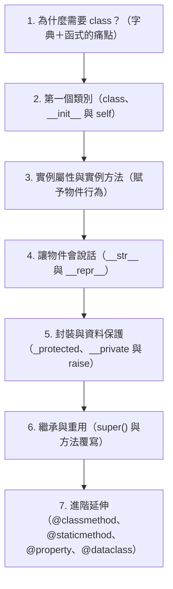
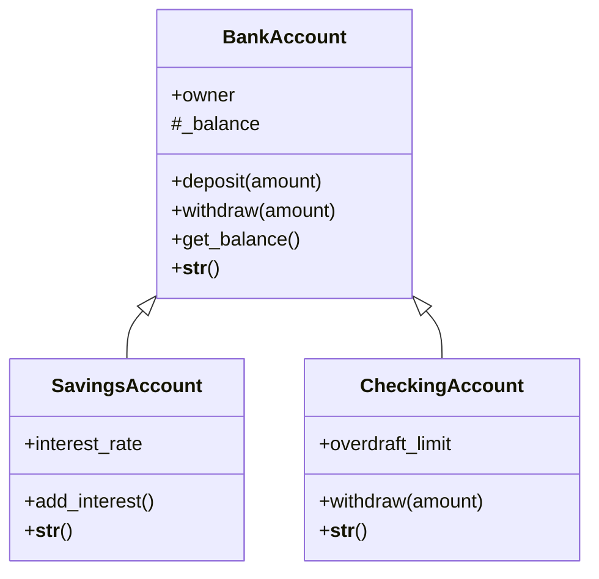

# Python 類別（`class`）：由淺至深入門實務指南

這份教材會帶你從「為什麼需要類別」開始，循序漸進掌握 Python 的物件導向程式設計（OOP）核心語法。課程分為四個階段：**基礎入門**、**物件互動與資料保護**、**繼承與重用**、**進階延伸**，並以生活化的「銀行帳戶（`BankAccount`）」範例貫穿演進，同時銜接 [try_except.md](./try_except.md) 學到的例外處理觀念。請打開 VS Code 或終端機，跟著每個階段實際執行範例。

## 課程學習地圖

在寫出第一行 `class` 之前，先透過這張學習路徑掌握從入門到進階的脈絡：



---

## 第一階段｜基礎入門（從零認識類別與物件）

### 1. 為什麼需要 `class`？從「字典＋函式」走向物件導向

在學會 `class` 之前，如果要管理兩個銀行帳戶，我們通常會用字典（`dict`）存資料，再寫幾個函式來操作這些字典：

```python
# 傳統寫法：資料（dict）與行為（函式）是分開的
acc1 = {"owner": "小明", "balance": 1000}
acc2 = {"owner": "小華", "balance": 500}

def deposit(account, amount):
    account["balance"] += amount

def show_info(account):
    print(f"戶名：{account['owner']}，餘額：{account['balance']} 元")

deposit(acc1, 500)
show_info(acc1)
show_info(acc2)
```

執行輸出：

```text
戶名：小明，餘額：1500 元
戶名：小華，餘額：500 元
```

當程式規模還小時這樣寫沒問題，但帳戶數量一多、規則一複雜，很快就會遇到三個痛點：
1. **資料與功能分離**：`acc1` 只是一包字典，它自己不知道自己能做存款、提款，開發者得記住要呼叫哪些函式。
2. **容易拼錯鍵名（Key）**：不小心寫成 `account["balence"]` 就會發生 `KeyError`，或是不小心塞入奇怪的欄位。
3. **資料沒有保護機制**：任何地方都能直接寫 `acc1["balance"] = -9999`，很容易改壞資料。

#### 什麼是「類別（Class）」與「物件（Object）」？

用生活化的比喻來理解：
- **類別（`class`）＝ 設計圖 / 餅乾模具**：定義「一個銀行帳戶應該有什麼資料，以及能做什麼動作」。設計圖本身還不是實際的帳戶。
- **實例 / 物件（Instance / Object）＝ 依設計圖做出來的實體 / 餅乾**：根據 `BankAccount` 這張設計圖實際開出來的 `acc1`（小明的帳戶）和 `acc2`（小華的帳戶），彼此資料獨立。
- **屬性（Attribute）＝ 物件身上的資料**：例如戶名（`owner`）、餘額（`balance`）。
- **方法（Method）＝ 寫在類別裡的函式（物件的行為）**：例如存款（`deposit`）、提款（`withdraw`）。

---

### 2. 建立第一個類別：`class`、`__init__` 與 `self`

現在我們把上面的帳戶設計成第一版 `BankAccount` 類別：

```python
class BankAccount:
    def __init__(self, owner, balance=0):
        self.owner = owner
        self.balance = balance

# 根據 BankAccount 設計圖，建立兩個彼此獨立的帳戶物件（實例）
acc1 = BankAccount("小明", 1000)
acc2 = BankAccount("小華")  # 未傳入 balance，使用預設值 0

print("acc1 戶名：", acc1.owner, "餘額：", acc1.balance)
print("acc2 戶名：", acc2.owner, "餘額：", acc2.balance)

# 修改 acc1 的餘額，不會影響到 acc2
acc1.balance = 2000
print("修改後 acc1 餘額：", acc1.balance)
print("此時 acc2 餘額：", acc2.balance)

# 檢查型別與實例關係
print("acc1 的型別：", type(acc1))
print("acc1 是 BankAccount 嗎？", isinstance(acc1, BankAccount))
```

執行輸出：

```text
acc1 戶名： 小明 餘額： 1000
acc2 戶名： 小華 餘額： 0
修改後 acc1 餘額： 2000
此時 acc2 餘額： 0
acc1 的型別： <class '__main__.BankAccount'>
acc1 是 BankAccount 嗎？ True
```

#### 新手必懂的三個核心重點

1. **命名慣例（Naming Convention）**
   - **類別名稱**使用大駝峰 `PascalCase`（每個單字字首大寫，如 `BankAccount`），方便一眼認出它是設計圖。
   - **變數、屬性與方法名稱**使用底線分隔的 `snake_case`（如 `acc1`、`owner`、`show_info`）。
2. **`__init__` 初始化方法**
   - 前後各有兩個底線，唸作「dunder init」（double underscore init）。
   - 每當你寫 `BankAccount("小明", 1000)` 建立新物件時，Python 會**自動執行 `__init__`**，把傳入的引數綁定到這個新物件身上。
3. **`self` 到底是什麼？**
   - `self` 代表**「正在被操作的那一個物件自己」**。
   - 建立 `acc1` 時，`self` 就是 `acc1`；建立 `acc2` 時，`self` 就是 `acc2`。
   - 定義方法時，`self` **必須寫在第一個參數**；但呼叫時（如 `BankAccount("小明", 1000)` 或之後呼叫 `acc1.deposit(500)`），Python 會自動把物件自己傳給 `self`，我們不需要自己手動傳。

---

### 3. 實例屬性與實例方法：讓物件擁有行為

只有資料的類別就像空的表格，加上**實例方法（Instance Method）**後，物件就能自己處理存款、提款與顯示資訊：

```python
class BankAccount:
    def __init__(self, owner, balance=0):
        # 實例屬性：每個物件各自擁有一份
        self.owner = owner
        self.balance = balance

    def deposit(self, amount):
        if amount <= 0:
            print("存款失敗：金額必須大於 0！")
            return
        self.balance += amount
        print(f"{self.owner} 存入 {amount} 元，目前餘額：{self.balance} 元")

    def withdraw(self, amount):
        if amount <= 0:
            print("提款失敗：金額必須大於 0！")
            return
        if amount > self.balance:
            print(f"{self.owner} 提款失敗：餘額不足（目前僅 {self.balance} 元）")
            return
        self.balance -= amount
        print(f"{self.owner} 提領 {amount} 元，剩餘餘額：{self.balance} 元")

    def show_info(self):
        print(f"【帳戶資訊】戶名：{self.owner}｜餘額：{self.balance} 元")

acc1 = BankAccount("小明", 1000)
acc1.show_info()
acc1.deposit(500)
acc1.withdraw(300)
acc1.withdraw(5000)
```

執行輸出：

```text
【帳戶資訊】戶名：小明｜餘額：1000 元
小明 存入 500 元，目前餘額：1500 元
小明 提領 300 元，剩餘餘額：1200 元
小明 提款失敗：餘額不足（目前僅 1200 元）
```

> [!NOTE]
> 在類別內部的方法中，透過 `self.balance` 就能讀取或修改該物件自己的屬性；呼叫 `self.show_info()` 也能呼叫同一個物件上的其他方法。

---

## 第二階段｜物件互動與資料保護（寫出更安全、好用的類別）

### 4. 讓物件「會說話」：`__str__` 與 `__repr__`

試著直接 `print(acc1)`，你會發現 Python 預設印出一串看不懂的記憶體位置：

```python
class BankAccount:
    def __init__(self, owner, balance=0):
        self.owner = owner
        self.balance = balance

acc1 = BankAccount("小明", 1000)
print(acc1)
```

執行輸出（`0x...` 的記憶體位址每次執行都會不同）：

```text
<__main__.BankAccount object at 0x102a3b4c0>
```

只要在類別中定義 `__str__` 與 `__repr__`，就能自訂物件轉成字串的樣子：

```python
class BankAccount:
    def __init__(self, owner, balance=0):
        self.owner = owner
        self.balance = balance

    def __str__(self):
        # 給「一般使用者」看的友善文字（print() 會優先使用這個）
        return f"銀行帳戶｜戶名：{self.owner}｜餘額：{self.balance} 元"

    def __repr__(self):
        # 給「工程師除錯」看的明確格式（放進 list 裡印出時會用這個）
        return f"BankAccount(owner={self.owner!r}, balance={self.balance})"

acc1 = BankAccount("小明", 1500)
acc2 = BankAccount("小華", 800)

print(acc1)              # 呼叫 __str__
print(repr(acc1))        # 呼叫 __repr__
print([acc1, acc2])      # 容器（list/dict）內的元素會使用 __repr__
```

執行輸出：

```text
銀行帳戶｜戶名：小明｜餘額：1500 元
BankAccount(owner='小明', balance=1500)
[BankAccount(owner='小明', balance=1500), BankAccount(owner='小華', balance=800)]
```

#### `__str__` vs `__repr__` 快速對照

| 方法 | 對象 | 觸發時機 | 設計原則 |
| :--- | :--- | :--- | :--- |
| `__str__(self)` | 一般使用者 | `print(obj)`、`str(obj)`、`f"{obj}"` | 讀起來自然、友善清楚即可 |
| `__repr__(self)` | 開發者（除錯用） | `repr(obj)`、在互動式終端直接輸入變數、印出 `list` / `dict` 內的元素 | 盡量清楚呈現類別名與關鍵屬性（若只寫其中一個，建議優先寫 `__repr__`，因為未定義 `__str__` 時會自動退回使用 `__repr__`） |

---

### 5. 封裝（Encapsulation）與資料保護：公開、`_protected` 與 `__private`

到目前為止，我們的 `acc1.balance` 依然是完全公開的。如果有段外部程式碼不小心寫了 `acc1.balance = -9999`，原本在 `deposit()` / `withdraw()` 做的檢查就全部破功了！

**封裝（Encapsulation）**的核心精神是：**把資料藏在物件內部，不讓外部隨意直接修改，只能透過物件提供的方法（窗口）安全地操作。**

Python 對於屬性的存取權限有三種命名慣例：

| 寫法 | 類型 | 意義與行為 | 使用建議 |
| :--- | :--- | :--- | :--- |
| `self.balance` | **公開（Public）** | 外部可自由讀取與修改 | 不需要特別保護的普通資料 |
| `self._balance` | **內部／受保護（Protected，慣例）** | 單底線開頭。語法上其實還是改得到，但代表「這是內部屬性，外部請勿直接動手」 | **Python 社群最常用**的內部屬性寫法 |
| `self.__pin` | **私有（Private，名稱修飾）** | 雙底線開頭。Python 會觸發 Name Mangling，將屬性自動改名為 `_類別名__pin`，防止外部或子類別意外撞名存取 | 真的需要避免誤觸或避免子類別覆蓋的敏感欄位 |

接下來我們升級 `BankAccount`：
1. 把餘額改成受保護的 `self._balance`，並把提款密碼設為私有的 `self.__pin`。
2. 遇到金額不合法或餘額不足時，結合 [try_except.md](./try_except.md) 學到的 **`raise ValueError(...)`** 主動報錯，讓呼叫端用 `try...except` 精準攔截！

```python
class BankAccount:
    def __init__(self, owner, balance=0, pin="0000"):
        if balance < 0:
            raise ValueError("開戶餘額不可為負數！")
        self.owner = owner
        self._balance = balance   # 單底線：內部受保護屬性
        self.__pin = pin          # 雙底線：私有屬性（會觸發名稱修飾）

    def get_balance(self):
        return self._balance

    def deposit(self, amount):
        if amount <= 0:
            raise ValueError(f"存款金額必須大於 0（收到：{amount}）")
        self._balance += amount
        return self._balance

    def withdraw(self, amount, pin):
        if pin != self.__pin:
            raise ValueError("密碼錯誤，無法提款！")
        if amount <= 0:
            raise ValueError(f"提款金額必須大於 0（收到：{amount}）")
        if amount > self._balance:
            raise ValueError(f"餘額不足！目前餘額 {self._balance} 元，無法提領 {amount} 元")
        self._balance -= amount
        return self._balance

    def __str__(self):
        return f"銀行帳戶｜戶名：{self.owner}｜餘額：{self._balance} 元"

acc = BankAccount("小明", 1000, pin="1234")
print(acc)

# 透過合法方法操作，並搭配 try...except 處理錯誤
for action in [("deposit", 500, None), ("withdraw", 300, "9999"), ("withdraw", 2000, "1234")]:
    kind, amt, pin = action
    try:
        if kind == "deposit":
            new_bal = acc.deposit(amt)
            print(f"存款 {amt} 元成功，最新餘額：{new_bal} 元")
        else:
            new_bal = acc.withdraw(amt, pin)
            print(f"提款 {amt} 元成功，最新餘額：{new_bal} 元")
    except ValueError as e:
        print(f"交易失敗：{e}")

# 驗證雙底線名稱修飾效果
print("hasattr(acc, '__pin')：", hasattr(acc, "__pin"))
print("Name Mangling 後實際名稱的值：", acc._BankAccount__pin)
```

執行輸出：

```text
銀行帳戶｜戶名：小明｜餘額：1000 元
存款 500 元成功，最新餘額：1500 元
交易失敗：密碼錯誤，無法提款！
交易失敗：餘額不足！目前餘額 1500 元，無法提領 2000 元
hasattr(acc, '__pin')： False
Name Mangling 後實際名稱的值： 1234
```

> [!TIP]
> 在類別裡面遇到不合法操作時，**用 `raise ValueError(...)` 比單純 `print("錯誤")` 更好**：呼叫端可以用 `try...except` 決定要顯示提示訊息、重試或記錄 Log，程式邏輯不會默默帶錯繼續跑。

---

## 第三階段｜繼承與重用（避免重複造輪子）

### 6. 繼承（Inheritance）基礎、方法覆寫（Override）與 `super()`

銀行的帳戶不只有一種！除了基本帳戶，通常還有：
- **儲蓄帳戶（`SavingsAccount`）**：擁有基本帳戶的所有功能，另外多了「利率（`interest_rate`）」與「計息（`add_interest`）」功能。
- **支票帳戶（`CheckingAccount`）**：擁有基本帳戶的所有功能，但允許在「透支額度（`overdraft_limit`）」內提款。

如果每個類別都重寫一次 `owner`、`_balance`、`deposit()`，程式碼會大量重複。透過**繼承（Inheritance）**，子類別可以直接沿用父類別的屬性與方法，只專注寫「不一樣的地方」。



來看看實際的程式碼實作：

```python
class BankAccount:
    def __init__(self, owner, balance=0):
        if balance < 0:
            raise ValueError("開戶餘額不可為負數！")
        self.owner = owner
        self._balance = balance

    def get_balance(self):
        return self._balance

    def deposit(self, amount):
        if amount <= 0:
            raise ValueError("存款金額必須大於 0")
        self._balance += amount
        return self._balance

    def withdraw(self, amount):
        if amount <= 0:
            raise ValueError("提款金額必須大於 0")
        if amount > self._balance:
            raise ValueError(f"餘額不足（目前 {self._balance} 元）")
        self._balance -= amount
        return self._balance

    def __str__(self):
        return f"一般帳戶｜戶名：{self.owner}｜餘額：{self._balance} 元"


class SavingsAccount(BankAccount):
    def __init__(self, owner, balance=0, interest_rate=0.02):
        # 呼叫父類別的 __init__，重複利用既有的初始化與檢查邏輯
        super().__init__(owner, balance)
        self.interest_rate = interest_rate

    def add_interest(self):
        interest = round(self._balance * self.interest_rate)
        if interest > 0:
            self.deposit(interest)  # 直接重用父類別的 deposit 方法
        return interest

    def __str__(self):
        return f"儲蓄帳戶｜戶名：{self.owner}｜餘額：{self._balance} 元｜利率：{self.interest_rate:.1%}"


class CheckingAccount(BankAccount):
    def __init__(self, owner, balance=0, overdraft_limit=5000):
        super().__init__(owner, balance)
        self.overdraft_limit = overdraft_limit

    # 方法覆寫（Override）：重新定義提款規則，允許在透支額度內提款
    def withdraw(self, amount):
        if amount <= 0:
            raise ValueError("提款金額必須大於 0")
        if amount > self._balance + self.overdraft_limit:
            raise ValueError(f"超過可用額度（餘額＋透支上限共 {self._balance + self.overdraft_limit} 元）")
        self._balance -= amount
        return self._balance

    def __str__(self):
        return f"支票帳戶｜戶名：{self.owner}｜餘額：{self._balance} 元｜透支上限：{self.overdraft_limit} 元"


s = SavingsAccount("小明", 10000, interest_rate=0.03)
earned = s.add_interest()
print(f"小明領到利息：{earned} 元")
print(s)

c = CheckingAccount("小華", 1000, overdraft_limit=3000)
c.withdraw(2500)  # 餘額會變成 -1500，但在透支上限 3000 內允許提領
print(c)

# 檢查繼承與實例關係
print("s 是 SavingsAccount 嗎？", isinstance(s, SavingsAccount))
print("s 也是 BankAccount 嗎？", isinstance(s, BankAccount))
print("SavingsAccount 是 BankAccount 的子類別嗎？", issubclass(SavingsAccount, BankAccount))
```

執行輸出：

```text
小明領到利息：300 元
儲蓄帳戶｜戶名：小明｜餘額：10300 元｜利率：3.0%
支票帳戶｜戶名：小華｜餘額：-1500 元｜透支上限：3000 元
s 是 SavingsAccount 嗎？ True
s 也是 BankAccount 嗎？ True
SavingsAccount 是 BankAccount 的子類別嗎？ True
```

> [!TIP]
> **什麼時候才該使用繼承？記住「is-a（是一種）」原則！**
> `SavingsAccount` **是一種** `BankAccount`，所以適合繼承。如果只是想「使用」另一個物件的功能（例如 `Customer` 客戶**擁有**一個 `BankAccount`，不是「是一種」帳戶），應該把它當成屬性放進類別裡（稱為**組合 Composition**，例如 `self.account = BankAccount(...)`），不要為了共用程式碼而強行繼承！

---

## 第四階段｜進階延伸（現代 Python 類別工具）

> [!NOTE]
> 前三個階段為了讓你專心掌握物件導向的核心觀念，刻意省略了型別標註。從本階段開始，我們會自然加入 **Python 3.12 的型別註記（Type Hints）**（例如 `owner: str`、`amount: int | float`、`-> None`），除了能讓編輯器提示更清楚，也是後面 `@dataclass` 語法必備的基礎。

---

### 7. 類別屬性 vs 實例屬性，以及 `@classmethod` 與 `@staticmethod`

寫類別時，資料與方法並不一定都屬於「單一實例」，有時是「整個類別共同擁有」的：

1. **實例屬性（Instance Attribute）**：寫在 `self.xxx` 上，每個物件各有一份（如每個人的戶名 `owner`、餘額 `_balance`）。
2. **類別屬性（Class Attribute）**：直接寫在 `class` 區塊內、方法外面，**所有實例共用同一份**（如銀行名稱 `bank_name`、總開戶數 `total_accounts`）。

同時，除了預設綁定 `self` 的**實例方法**，Python 還提供兩個裝飾器：
- **`@classmethod`（類別方法）**：第一個參數是 `cls`（代表類別本身），常用來讀取或修改類別屬性，或是當成**替代建構子**（例如從字串或字典建立物件）。
- **`@staticmethod`（靜態方法）**：不需要 `self` 也不需要 `cls`，單純是一個跟這個類別主題相關的工具函式。

```python
class BankAccount:
    # 類別屬性：所有帳戶共用
    bank_name: str = "Python 數位銀行"
    total_accounts: int = 0

    def __init__(self, owner: str, balance: int | float = 0) -> None:
        self.owner = owner          # 實例屬性：各自獨立
        self._balance = balance
        BankAccount.total_accounts += 1

    # 實例方法：需要操作單一物件（self）
    def __str__(self) -> str:
        return f"[{self.bank_name}] {self.owner}｜餘額：{self._balance} 元"

    # 類別方法：第一個參數是 cls（類別本身），適合當作「替代建構子」
    @classmethod
    def from_string(cls, text: str) -> "BankAccount":
        owner, raw_balance = text.split(",")
        return cls(owner.strip(), int(raw_balance.strip()))

    @classmethod
    def get_total_accounts(cls) -> int:
        return cls.total_accounts

    # 靜態方法：不需要 self 或 cls，純粹做工具檢查
    @staticmethod
    def is_valid_amount(amount: int | float) -> bool:
        return not isinstance(amount, bool) and isinstance(amount, (int, float)) and amount > 0


acc1 = BankAccount("小明", 1000)
acc2 = BankAccount.from_string("小華, 2500")  # 用類別方法從字串建立物件

print(acc1)
print(acc2)
print("目前總開戶數：", BankAccount.get_total_accounts())
print("500 是有效金額嗎？", BankAccount.is_valid_amount(500))
print("-100 是有效金額嗎？", BankAccount.is_valid_amount(-100))

# 注意類別屬性與實例遮蔽（Shadowing）的差別
BankAccount.bank_name = "Python 雲端銀行"
print("全行改名後 acc1：", acc1.bank_name)
acc1.bank_name = "小明私人金庫"  # 只在 acc1 身上建立同名的實例屬性，蓋住了類別屬性
print("只改 acc1 後，acc1：", acc1.bank_name)
print("只改 acc1 後，acc2：", acc2.bank_name)
```

執行輸出：

```text
[Python 數位銀行] 小明｜餘額：1000 元
[Python 數位銀行] 小華｜餘額：2500 元
目前總開戶數： 2
500 是有效金額嗎？ True
-100 是有效金額嗎？ False
全行改名後 acc1： Python 雲端銀行
只改 acc1 後，acc1： 小明私人金庫
只改 acc1 後，acc2： Python 雲端銀行
```

#### 三種方法快速比較

| 方法類型 | 裝飾器 | 第一個參數 | 可以存取什麼？ | 常見用途 |
| :--- | :--- | :--- | :--- | :--- |
| **實例方法** | 無 | `self`（物件自己） | 實例屬性 + 類別屬性 | 存取/修改物件狀態（如 `deposit`、`withdraw`） |
| **類別方法** | `@classmethod` | `cls`（類別自己） | 類別屬性 | 替代建構子（`from_string`）、統計/管理整個類別 |
| **靜態方法** | `@staticmethod` | 無規定 | 僅參數傳入的值 | 屬於該領域但不需要物件或類別狀態的純工具函式 |

---

### 8. `@property` 屬性驗證：像屬性一樣好讀，像方法一樣安全

在第二階段，我們為了保護 `_balance` 不被亂改，寫了 `acc.get_balance()`。但如果能直接寫 `acc.balance` 讀取、寫 `acc.balance = 500` 修改，同時背後又能自動執行驗證檢查，豈不是兩全其美？

這就是 **`@property`** 的魔力！它能讓你做出三種好用的屬性：
1. **唯讀屬性**：只寫 `@property`，不寫 setter（例如 `owner` 開戶後不允許隨意改名）。
2. **可讀可寫＋自動驗證**：同時寫 `@property` 與 `@balance.setter`（甚至在 `__init__` 裡直接寫 `self.balance = balance`，就能讓開戶與後續修改共用同一套驗證！）。
3. **動態計算屬性**：依現有資料即時算出結果（例如 `is_vip` 判斷餘額是否達 10 萬元）。

```python
class BankAccount:
    def __init__(self, owner: str, balance: int | float = 0) -> None:
        self._owner = owner
        self.balance = balance  # 會自動觸發下面的 @balance.setter 驗證！

    @property
    def owner(self) -> str:
        """唯讀屬性：外部可以讀取 acc.owner，但不能直接改寫。"""
        return self._owner

    @property
    def balance(self) -> int | float:
        """讀取餘額（getter）。"""
        return self._balance

    @balance.setter
    def balance(self, value: int | float) -> None:
        """修改餘額前自動檢查（setter）。"""
        if isinstance(value, bool) or not isinstance(value, (int, float)):
            raise TypeError("餘額必須是數字")
        if value < 0:
            raise ValueError(f"餘額不可為負數（收到：{value}）")
        self._balance = value

    @property
    def is_vip(self) -> bool:
        """計算屬性：根據當前餘額即時判定是否為 VIP。"""
        return self._balance >= 100_000


acc = BankAccount("小明", 50000)
print("戶名：", acc.owner)
print("目前餘額：", acc.balance)
print("是否為 VIP：", acc.is_vip)

acc.balance = 120000  # 觸發 setter，合法所以通過
print("加碼後餘額：", acc.balance, "｜VIP：", acc.is_vip)

# 嘗試改寫唯讀屬性 owner
try:
    acc.owner = "大華"
except AttributeError as e:
    print(f"修改唯讀屬性失敗：{e}")

# 嘗試把餘額改成負數
try:
    acc.balance = -500
except ValueError as e:
    print(f"修改餘額失敗：{e}")
```

執行輸出：

```text
戶名： 小明
目前餘額： 50000
是否為 VIP： False
加碼後餘額： 120000 ｜VIP： True
修改唯讀屬性失敗：property 'owner' of 'BankAccount' object has no setter
修改餘額失敗：餘額不可為負數（收到：-500）
```

> [!IMPORTANT]
> 在 `@balance.setter` 裡面，存資料時**一定要寫 `self._balance = value`**（帶底線的內部屬性），千萬不要寫成 `self.balance = value`，否則 setter 會不斷呼叫自己，最後引發 `RecursionError`（無限遞迴錯誤）！

---

### 9. `@dataclass` 簡介：用更少的程式碼建立資料類別

假設我們想為銀行系統加上「交易明細（`Transaction`）」，每筆交易包含：交易類型 `kind`、金額 `amount` 與備註 `note`。

如果用傳統方式寫一個純粹裝資料的類別，光是 `__init__`、`__repr__` 與讓兩筆內容相同的資料可以比較相等的 `__eq__`，就得寫一大段重複樣板程式：

```python
# 傳統寫法：光是存 3 個欄位就要寫這麼多重複程式碼
class TransactionManual:
    def __init__(self, kind: str, amount: int | float, note: str = "") -> None:
        self.kind = kind
        self.amount = amount
        self.note = note

    def __repr__(self) -> str:
        return f"TransactionManual(kind={self.kind!r}, amount={self.amount!r}, note={self.note!r})"

    def __eq__(self, other: object) -> bool:
        if not isinstance(other, TransactionManual):
            return NotImplemented
        return (self.kind, self.amount, self.note) == (other.kind, other.amount, other.note)
```

從 Python 3.7 起，標準函式庫內建的 **`@dataclass`** 裝飾器可以幫我們自動產生 `__init__`、`__repr__` 與 `__eq__`！

```python
from dataclasses import dataclass, field


@dataclass
class Transaction:
    kind: str
    amount: int | float
    note: str = ""  # 不可變預設值（字串、數字、布林）可直接寫


@dataclass
class AccountSummary:
    owner: str
    # 可變預設值（如 list、dict）必須用 field(default_factory=...)，才不會所有實例共用同一個串列
    transactions: list[Transaction] = field(default_factory=list)


t1 = Transaction("存款", 1000, "薪資入帳")
t2 = Transaction("存款", 1000, "薪資入帳")
t3 = Transaction("提款", 200)  # note 使用預設值 ""

print(t1)                  # 自動產生的 __repr__
print("t1 == t2 嗎？", t1 == t2)  # 自動產生的 __eq__，比較欄位值而非記憶體位置
print("t1 == t3 嗎？", t1 == t3)

summary = AccountSummary("小明")
summary.transactions.append(t1)
summary.transactions.append(t3)
print("交易筆數：", len(summary.transactions))
print(summary)
```

執行輸出：

```text
Transaction(kind='存款', amount=1000, note='薪資入帳')
t1 == t2 嗎？ True
t1 == t3 嗎？ False
交易筆數： 2
AccountSummary(owner='小明', transactions=[Transaction(kind='存款', amount=1000, note='薪資入帳'), Transaction(kind='提款', amount=200, note='')])
```

#### 什麼時候用一般 `class`，什麼時候用 `@dataclass`？

| 情況 | 建議選擇 | 原因 |
| :--- | :--- | :--- |
| 主要是「打包一組資料欄位」（如交易紀錄、商品資料、設定物件） | **`@dataclass`** | 省去大量樣板程式，自帶漂亮的 `__repr__` 與欄位比對 `__eq__` |
| 有複雜的狀態操作、需要大量 `@property` 驗證、繼承多層行為 | **一般 `class`** | 流程控制與封裝邏輯最直覺、彈性最大 |

---

### 10. 初學者常見地雷與反模式（Anti-patterns）對照表

| 常見壞寫法 / 地雷 | 會發生什麼事？ | 正確寫法 / 改善建議 |
| :--- | :--- | :--- |
| 定義方法忘記寫 `self`<br>`def show(): ...` | 呼叫 `acc.show()` 時發生 `TypeError: ... takes 0 positional arguments but 1 was given` | 實例方法第一個參數一定要寫 `self`（`def show(self):`） |
| 把 `list` / `dict` 直接寫成類別屬性或 `__init__` 預設參數 | **所有實例會共用同一個串列！**改一個物件，全部物件的資料都被改壞 | 在 `__init__` 內寫 `self.items = []`，或在 `@dataclass` 用 `field(default_factory=list)` |
| 子類別覆寫 `__init__` 卻忘了呼叫 `super().__init__()` | 父類別設定的屬性（如 `self.owner`）根本沒被建立，後續存取時出現 `AttributeError` | 子類別 `__init__` 開頭務必補上 `super().__init__(...)` |
| 到處濫用雙底線 `self.__balance` | 外部與子類別都難以除錯或擴充，反而失去彈性 | 優先使用單底線 `self._balance` 搭配 `@property` 驗證即可 |
| 把不具 `is-a` 關係的類別強行繼承，或把 `class` 當工具箱硬塞一堆無關函式 | 類別階層變得混亂難懂，維護成本暴增 | 沒共用狀態的純工具直接寫一般函式（Module）；「擁有某物件」改用組合（屬性）而非繼承 |

#### 地雷實測對照：可變預設值為什麼危險？

```python
# 反面教材：直接把 [] 寫在類別屬性（或寫成 def __init__(self, history=[]):）
class BadAccount:
    history = []  # 危險！所有 BadAccount 實例共用這同一個 list

    def __init__(self, owner):
        self.owner = owner

    def add_record(self, record):
        self.history.append(record)

a = BadAccount("小明")
b = BadAccount("小華")
a.add_record("存入 100")
print("反面教材 b.history（小華什麼都沒做卻有紀錄！）：", b.history)


# 正確寫法：在 __init__ 裡面為每個實例建立獨立的新串列
class GoodAccount:
    def __init__(self, owner):
        self.owner = owner
        self.history = []  # 每個實例各自擁有一份全新的 list

    def add_record(self, record):
        self.history.append(record)

c = GoodAccount("小明")
d = GoodAccount("小華")
c.add_record("存入 100")
print("正確寫法 d.history：", d.history)
```

執行輸出：

```text
反面教材 b.history（小華什麼都沒做卻有紀錄！）： ['存入 100']
正確寫法 d.history： []
```

---

## 附錄｜課堂工具箱

### 語法速查總表

| 語法 / 關鍵字 | 用途說明 | 最小範例 |
| :--- | :--- | :--- |
| `class Name:` | 定義一個類別（大駝峰命名） | `class BankAccount:` |
| `def __init__(self, ...):` | 初始化方法，建立實例時自動執行 | `def __init__(self, owner): self.owner = owner` |
| `self` | 代表當前正在被操作的實例物件 | `self.balance += amount` |
| `def __str__(self):` | 定義 `print(obj)` 顯示的友善字串 | `return f"戶名：{self.owner}"` |
| `def __repr__(self):` | 定義除錯與容器內顯示的物件表示字串 | `return f"BankAccount({self.owner!r})"` |
| `self._attr` / `self.__attr` | 慣例保護屬性（單底線）／名稱修飾私有屬性（雙底線） | `self._balance = 0` |
| `class Child(Parent):` | 定義繼承父類別的子類別 | `class SavingsAccount(BankAccount):` |
| `super().__init__(...)` | 在子類別中呼叫父類別方法 | `super().__init__(owner, balance)` |
| `isinstance()` / `issubclass()` | 檢查物件所屬型別／類別繼承關係 | `isinstance(s, BankAccount)` |
| `@classmethod` | 定義類別方法，第一個參數為 `cls` | `@classmethod def from_string(cls, text):` |
| `@staticmethod` | 定義靜態方法，不依賴 `self` 與 `cls` | `@staticmethod def is_valid_amount(n):` |
| `@property` / `@x.setter` | 用屬性語法觸發讀取、計算或寫入驗證 | `@balance.setter def balance(self, v): ...` |
| `@dataclass` | 自動產生 `__init__`、`__repr__`、`__eq__` | `@dataclass class Transaction:` |

---

### 分級練習題

請先動手自己寫寫看，寫完或卡關時再點擊下方的提示檢查方向：

#### 基礎題
1. **寵物檔案 `Pet`**
   請建立一個 `Pet` 類別：
   - `__init__(self, name, species, hunger=50)`：`hunger` 代表飢餓值（0 表示吃飽，100 表示超餓）。
   - `feed(self, food=20)`：減少飢餓值（最低到 `0`，不可變負數），並印出餵食後的狀態。
   - `play(self)`：陪寵物玩會讓 `hunger` 增加 `15`（最高到 `100`）。
   - `__str__(self)`：回傳如 `"小橘（貓）｜飢餓度：30/100"` 的字串。
2. **商品庫存 `Product`**
   請建立一個 `Product` 類別：
   - 屬性包含公開的 `name`、受保護的 `_price` 與 `_stock`（若價格或庫存小於 `0`，在 `__init__` 直接 `raise ValueError`）。
   - 撰寫 `restock(self, qty)`（補貨）與 `sell(self, qty)`（銷售）：若 `qty <= 0` 或銷售數量超過 `_stock`，請使用 `raise ValueError` 拋出清楚的錯誤訊息。

#### 進階題
3. **員工薪資繼承 `Employee` 與 `Manager`**
   - 建立父類別 `Employee(name, monthly_salary)`，提供 `annual_salary()` 回傳 `monthly_salary * 12`。
   - 建立子類別 `Manager(Employee)`，在 `__init__` 接收額外參數 `bonus`，使用 `super().__init__(name, monthly_salary)` 初始化父類別屬性，並**覆寫** `annual_salary()`，回傳 `super().annual_salary() + bonus`。
4. **溫度計 `Temperature`（`@property` + `@classmethod`）**
   - 使用 `@property` 與 `@celsius.setter` 管理 `_celsius`，若設定值低於絕對零度 `-273.15`，請 `raise ValueError("溫度不可低於絕對零度 -273.15°C")`。
   - 提供唯讀計算屬性 `fahrenheit`（公式：`celsius * 9 / 5 + 32`）。
   - 提供 `@classmethod def from_fahrenheit(cls, f: float) -> "Temperature"`，能直接從華氏溫度建立 `Temperature` 物件。

#### 挑戰題
5. **結合 `BankAccount` 與 `@dataclass` 的 `Transaction` 對帳系統**
   - 建立 `@dataclass class Transaction(kind: str, amount: int | float, note: str = "")`。
   - 升級 `BankAccount`：
     - 使用 `@property` 保護 `balance`（不可為負）。
     - 在 `__init__` 建立獨立的 `self._history: list[Transaction] = []`。
     - 每次成功 `deposit` 或 `withdraw` 後，把一筆 `Transaction` 加進 `self._history`。
     - 實作 `print_statement(self)`，依序印出每一筆交易明細與目前總餘額，並搭配 `try...except ValueError` 測試各種不合法操作。

<details>
<summary>點擊展開練習題參考提示</summary>

1. 第 1 題：在 `feed` 中可使用 `self.hunger = max(0, self.hunger - food)`，在 `play` 中使用 `self.hunger = min(100, self.hunger + 15)`，即可輕鬆限制在 `0～100` 之間。
2. 第 2 題：先驗證 `qty <= 0` 再驗證 `qty > self._stock`，兩個情況都 `raise ValueError(...)`，最後測試時用 `try...except ValueError as e:` 接住印出。
3. 第 3 題：`Manager.annual_salary(self)` 裡面可以寫 `return super().annual_salary() + self.bonus`，不用自己再重複寫一次 `* 12`。
4. 第 4 題：在 `from_fahrenheit(cls, f)` 中先算 `c = (f - 32) * 5 / 9`，再回傳 `cls(c)`；因為會呼叫 `__init__`，所以也會自動觸發 `@celsius.setter` 的絕對零度檢查。
5. 第 5 題：若開戶初始餘額大於 `0`，也可以在 `__init__` 記錄一筆 `Transaction("開戶", balance)`；`print_statement` 中用 `for i, tx in enumerate(self._history, start=1):` 印出編號更整齊。

</details>

---

### 常見問題（FAQ）

- **Q1：`self` 一定要叫做 `self` 嗎？換成其他名字可以嗎？**
  語法上 Python 只規定「實例方法的第一個參數會接收物件本身」，換成 `this` 或 `me` 程式也能執行；但全世界的 Python 開發者都約定俗成使用 `self`，遵守這個慣例才不會讓別人（或自己未來）看不懂。
- **Q2：`__init__` 裡面需要寫 `return` 嗎？**
  **不需要，也不能回傳非 `None` 的值！** `__init__` 的工作是「初始化已經建立好的 `self`」，如果硬在裡面 `return 123`，Python 會直接拋出 `TypeError: __init__() should return None, not 'int'`。
- **Q3：什麼時候該寫 `class`，什麼時候寫一般函式（`def`）就好？**
  如果只是「輸入資料 → 算完回傳結果」，沒有需要長期記住的狀態，寫一般函式最簡潔；當你發現**有一組資料需要一直跟著好幾個函式跑**（例如帳戶一直要記住餘額並做存提款），就是適合用 `class` 把資料與行為打包在一起的時機。
- **Q4：既然單底線 `_balance` 外部硬改還是改得到，為什麼大家不用雙底線 `__balance` 就好？**
  Python 社群信奉「我們都是負責任的大人（We are all consenting adults）」哲學：`_balance` 就像門上的「員工專用，請勿擅入」告示牌，已足夠提醒開發者透過 `@property` 或方法存取，同時保留測試與除錯時的彈性；雙底線 `__balance` 主要用來防止子類別意外覆寫同名屬性，而非真正的資安鎖。
- **Q5：`@dataclass` 建立的類別也可以自己加方法、繼承或搭配 `@property` 嗎？**
  **完全可以！** `@dataclass` 產生的依然是一個標準的 Python `class`，差別只在於裝飾器幫你自動補上了 `__init__`、`__repr__`、`__eq__` 等重複程式碼，你依然可以在裡面自由加入一般方法、類別方法或繼承其他 `@dataclass`。

---

### 課堂完成檢查清單（Checklist）

- [ ] 理解類別（設計圖）與實例（物件）的差異，能用 `class`、`__init__` 與 `self` 建立彼此獨立的物件。
- [ ] 能為類別撰寫實例方法操作內部狀態，並透過 `__str__` 與 `__repr__` 輸出友善且便於除錯的文字。
- [ ] 了解公開、`_protected` 與 `__private` 的差異，並能搭配 `raise ValueError` 與 `try...except` 保護資料不被改壞。
- [ ] 能使用繼承、`super().__init__()` 與方法覆寫重用父類別功能，並知道「is-a」與組合的差別。
- [ ] 分得清楚類別屬性與實例屬性，並知道實例方法、`@classmethod`、`@staticmethod` 各自的使用時機。
- [ ] 能使用 `@property` 與 `@x.setter` 做出唯讀屬性、驗證屬性與動態計算屬性。
- [ ] 能用 `@dataclass`（含 `field(default_factory=list)`）快速建立乾淨的資料類別，並避開可變預設值等地雷。
