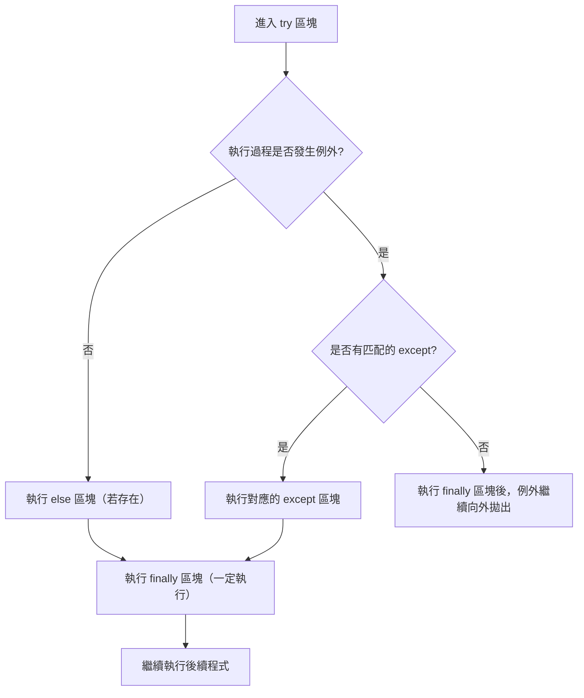

# Python `try-except` 例外處理完全指南（由淺至深）

這份教材為 `2026_11_25` 課程設計，會帶你從最基礎的錯誤辨識開始，一步步學會 `try...except` 的精準攔截、完整流程控制 `else` / `finally`、主動拋出例外 `raise`、例外鏈與自訂例外，最後銜接實戰防呆、單元測試（結合本目錄的 `calc.py` 與 `tests/test_calc.py`）以及 Python 3.11+ 的 `except*` 語法。

---

## 學習地圖（由淺至深五階段）

1. **第 1 階段（入門基礎）**：分清語法錯誤與執行期例外、看懂 Traceback、基本的 `try...except`
2. **第 2 階段（精準捕捉）**：多重 `except`、合併捕捉 `(ErrA, ErrB)`、`as e` 取得訊息與例外繼承階層
3. **第 3 階段（完整流程）**：`try...except...else...finally` 各區塊職責、`return` 與 `finally` 的關係、`with` 資源管理
4. **第 4 階段（主動控管）**：`raise` 檢查商業邏輯（結合 `calc.py`）、重新拋出、`raise ... from e` 例外鏈與自訂例外
5. **第 5 階段（實戰與進階）**：`while True` 輸入防呆、EAFP vs LBYL 思維、`unittest` 測試例外，以及 Python 3.11+ `ExceptionGroup` / `except*`

---

## 第 1 階段：入門基礎 —— 認識錯誤與最基本的 `try...except`

### 1.1 語法錯誤（`SyntaxError`）vs 例外（`Exception`）

在 Python 中，程式出錯主要分成兩大類：

| 類型 | 發生時機 | 能否用 `try...except` 攔截 | 常見例子 |
| :--- | :--- | :--- | :--- |
| **語法錯誤（`SyntaxError`）** | 執行前（編譯/解析階段） | **不能**，必須直接修正程式碼 | 少寫冒號 `:`、括號沒成對、縮排錯誤 |
| **例外（`Exception` / 執行期錯誤）** | 程式執行到一半時 | **可以**，透過 `try...except` 處理 | 除以 `0`、`int("abc")`、讀取不存在的檔案 |

```python
# 語法錯誤：程式根本無法開始執行（取消註解就會直接報 SyntaxError）
# if True
#     print("Hello")

# 執行期例外：語法完全正確，但執行到第 2 行才中斷
print("程式開始")
result = 10 / 0
print("程式結束")  # 這一行不會被執行到
```

### 1.2 如何看懂 Traceback（錯誤追蹤訊息）？

執行上面的 `10 / 0` 範例時，會看到類似下面的輸出：

```text
程式開始
Traceback (most recent call last):
  File "demo.py", line 2, in <module>
    result = 10 / 0
             ~~~^~~
ZeroDivisionError: division by zero
```

閱讀 Traceback 的兩個重點步驟：
1. **先看最後一行**：得知錯誤的**類型**（`ZeroDivisionError`）與**原因說明**（`division by zero`）。
2. **再往上看行號與箭頭**：找出錯誤發生在哪個檔案、第幾行（`line 2`）以及哪個算式。

### 1.3 常見內建例外一覽表

| 例外類型 | 常見觸發原因 | 範例 |
| :--- | :--- | :--- |
| `ZeroDivisionError` | 除數為 `0` | `10 / 0` |
| `ValueError` | 資料型別正確，但「內容值」不合法 | `int("abc")` |
| `TypeError` | 對不相容的資料型別進行運算或操作 | `"10" + 5` |
| `IndexError` | 存取 `list` / `tuple` 時索引超出範圍 | `[1, 2, 3][5]` |
| `KeyError` | 存取 `dict` 時使用了不存在的鍵（key） | `{"a": 1}["b"]` |
| `FileNotFoundError` | 嘗試開啟不存在的檔案 | `open("missing.txt")` |

### 1.4 最基本的 `try...except`

- **`try:`** 放入「可能會發生例外的程式碼」。
- **`except 例外類型:`** 放入「發生該例外時要執行的補救動作」。

```python
def split_bill(total: int | float, people: int) -> None:
    try:
        per_person = total / people
        print(f"每人應付：{per_person:.0f} 元")
    except ZeroDivisionError:
        print("錯誤：分攤人數不能為 0！")

split_bill(600, 3)
split_bill(600, 0)
print("結帳流程繼續進行...")
```

執行輸出：

```text
每人應付：200 元
錯誤：分攤人數不能為 0！
結帳流程繼續進行...
```

當 `people` 為 `0` 時，Python 會立刻跳出 `try` 區塊（不會執行下一行的 `print(f"每人應付：...")`），改為執行 `except ZeroDivisionError:` 區塊，接著繼續執行後面的程式，避免整個程式崩潰。

---

## 第 2 階段：精準捕捉 —— 多重 `except`、`as e` 與例外階層

同一段程式往往可能出現多種不同錯誤，這時可以運用多重 `except`、元組合併捕捉與 `as e`。

### 2.1 多重 `except` 與取得例外訊息（`as e`）

```python
def calc_unit_price(total_text: str, count_text: str) -> None:
    try:
        total = int(total_text)
        count = int(count_text)
        unit_price = total / count
        print(f"單價：{unit_price:.1f} 元")
    except ValueError as e:
        print(f"輸入格式錯誤，請輸入整數！（系統訊息：{e}）")
    except ZeroDivisionError:
        print("數量不能為 0，無法計算單價！")

calc_unit_price("500", "4")
calc_unit_price("五百", "4")
calc_unit_price("500", "0")
```

執行輸出：

```text
單價：125.0 元
輸入格式錯誤，請輸入整數！（系統訊息：invalid literal for int() with base 10: '五百'）
數量不能為 0，無法計算單價！
```

### 2.2 元組合併捕捉與保底防線 `Exception`

如果多種錯誤的處理方式相同，可以用元組 `(錯誤A, 錯誤B)` 寫在同一個 `except`；若有需要記錄未預期錯誤，可以在**最後**加上 `except Exception as e:`。

```python
def get_item(data: list[str] | None, index_text: str) -> None:
    try:
        index = int(index_text)
        print("取得項目：", data[index])  # type: ignore[index]
    except (ValueError, IndexError) as e:
        print(f"查詢失敗（格式或索引問題）：{e}")
    except Exception as e:
        print(f"發生未預期錯誤 [{type(e).__name__}]：{e}")

items = ["蘋果", "香蕉", "橘子"]
get_item(items, "1")    # 正常
get_item(items, "abc")  # ValueError
get_item(items, "10")   # IndexError
get_item(None, "0")     # TypeError -> 由最後的 Exception 接住
```

執行輸出：

```text
取得項目： 香蕉
查詢失敗（格式或索引問題）：invalid literal for int() with base 10: 'abc'
查詢失敗（格式或索引問題）：list index out of range
發生未預期錯誤 [TypeError]：'NoneType' object is not subscriptable
```

### 2.3 例外類別繼承階層與兩大禁忌

Python 的例外是有繼承關係的（節錄常見階層）：

```text
BaseException
 ├── KeyboardInterrupt      # 使用者按 Ctrl+C 中斷
 ├── SystemExit             # sys.exit() 結束程式
 └── Exception              # 一般程式應攔截的執行期例外父類別
      ├── ArithmeticError
      │    └── ZeroDivisionError
      ├── LookupError
      │    ├── IndexError
      │    └── KeyError
      ├── OSError
      │    └── FileNotFoundError
      ├── TypeError
      └── ValueError
```

> [!IMPORTANT]
> 1. **子類別（具體例外）必須寫在父類別（通用例外）前面**：例如把 `except Exception:` 放在 `except ValueError:` 前面，所有的 `ValueError` 都會先被 `Exception` 攔走，後面的 `except ValueError:` 永遠不會執行。同理，`LookupError` 也不能寫在 `IndexError` 前面。
> 2. **切勿寫空的 `except:`**：空的 `except:` 等同於捕捉最頂層的 `BaseException`，連 `Ctrl+C`（`KeyboardInterrupt`）與程式結束訊號（`SystemExit`）都會被吃掉，還會把拼錯變數造成的 `NameError` 靜靜掩蓋，極難除錯。

---

## 第 3 階段：完整流程 —— `try...except...else...finally` 與資源管理

### 3.1 四大區塊各自職責



- **`try`**：只放「真正可能拋出預期例外」的那幾行程式（保持精簡）。
- **`except`**：只有發生例外時才執行。
- **`else`**：**完全沒有發生例外**時才執行（適合放成功後的後續運算或回傳）。
- **`finally`**：**不管有沒有發生例外、甚至不管有沒有被 `except` 接住**，最後一定都會執行。

```python
def divide_numbers(a: float, b: float) -> None:
    print(f"--- 開始計算 {a} / {b} ---")
    try:
        result = a / b
    except ZeroDivisionError:
        print("[except] 失敗：除數不能為 0！")
    except TypeError:
        print("[except] 失敗：請傳入數字型別！")
    else:
        print(f"[else] 計算成功，結果為：{result}")
    finally:
        print("[finally] 清理資源並結束本次計算。\n")

divide_numbers(10, 2)
divide_numbers(10, 0)
```

執行輸出：

```text
--- 開始計算 10 / 2 ---
[else] 計算成功，結果為：5.0
[finally] 清理資源並結束本次計算。

--- 開始計算 10 / 0 ---
[except] 失敗：除數不能為 0！
[finally] 清理資源並結束本次計算。
```

> [!TIP]
> **為什麼成功後的程式碼要放進 `else`，而不是全部寫在 `try` 裡？**
> 因為這樣可以避免「成功後才做的步驟」意外拋出同類型錯誤，卻被前面的 `except` 誤捕，讓除錯邊界非常清楚。

### 3.2 `finally` 遇到 `return` 也會執行！

即使在 `try` 或 `except` 中已經執行 `return`，函式在真正回傳離開之前，依然會先把 `finally` 執行完畢：

```python
def demo_finally_with_return(flag: bool) -> str:
    try:
        if not flag:
            raise ValueError("觸發錯誤")
        return "從 try 回傳"
    except ValueError:
        return "從 except 回傳"
    finally:
        print("[finally] 無論如何我都會先執行！")

print(demo_finally_with_return(True))
print(demo_finally_with_return(False))
```

執行輸出：

```text
[finally] 無論如何我都會先執行！
從 try 回傳
[finally] 無論如何我都會先執行！
從 except 回傳
```

> [!WARNING]
> 不要在 `finally` 區塊內寫 `return`！如果在 `finally` 裡 `return`，會直接覆蓋掉 `try` / `except` 原本的回傳值，甚至會把原本未處理的例外默默吞掉。

### 3.3 資源清理：`try...finally` 與 `with` 陳述式

早期的資源關閉常寫成 `try...finally`：

```python
f = open("example.txt", "w", encoding="utf-8")
try:
    f.write("Hello Python")
finally:
    f.close()
```

實務上處理檔案、鎖（Lock）或網路連線時，更建議直接使用 **`with`（Context Manager）**，它會在離開區塊時自動執行等同 `finally` 的清理動作，即使過程中出錯也會安全關閉檔案：

```python
with open("example.txt", "w", encoding="utf-8") as f:
    f.write("Hello Python")
```

---

## 第 4 階段：主動控管 —— `raise`、例外鏈與自訂例外

### 4.1 主動拋出例外（`raise`）與函式分工

寫模組或工具函式時，**底層函式負責檢查並用 `raise` 回報錯誤，呼叫端負責用 `try...except` 決定如何處理或提示使用者**。

以本目錄的 [calc.py](file:///C:/Users/User/Documents/2026_11_04_tvdi_python/2026_11_25/calc.py) 為例：

```python
# 2026_11_25/calc.py
def divide(a: int | float, b: int | float) -> float:
    """計算 a 除以 b 的商，當除數為 0 時拋出 ValueError。"""
    if b == 0:
        raise ValueError("除數不可為零")
    return a / b
```

呼叫端可以這樣搭配使用：

```python
from calc import divide

try:
    ans = divide(10, 0)
except ValueError as e:
    print(f"計算中止：{e}")
else:
    print(f"計算結果：{ans}")
```

為什麼不在 `divide()` 裡面直接 `print("除數不可為零")` 而要用 `raise`？
因為 `print()` 只能把字印在畫面上，呼叫這支函式的上層程式（例如網頁 API、GUI 介面或單元測試）完全無法得知計算失敗，也沒辦法做出對應補救；改用 `raise ValueError("除數不可為零")`，就能把明確的錯誤訊號傳遞給呼叫端處理。

### 4.2 重新拋出（Re-raise）與例外鏈（`raise ... from ...`）

在實務專案中，捕捉到例外後常常有三種處理策略：

1. **單獨寫 `raise`（原樣重新拋出）**：先在 `except` 記錄 log，再把原本的例外原封不動往外送，保留最完整的原始 Traceback。
2. **`raise 新例外 from e`（保留因果鏈）**：把底層技術性錯誤（例如 `ValueError`）包裝成更有業務語意的例外（例如 `ConfigError`），同時透過 `__cause__` 保留原始原因。
3. **`raise 新例外 from None`（隱藏底層實作細節）**：若不想把底層冗長或敏感的錯誤訊息暴露給使用者，可以用 `from None` 切斷例外鏈。

```python
class ConfigError(Exception):
    """設定檔解析失敗時拋出的例外。"""

def load_port(port_text: str) -> int:
    try:
        return int(port_text)
    except ValueError as e:
        raise ConfigError(f"無法解析連接埠設定：{port_text!r}") from e

try:
    load_port("abc")
except ConfigError as e:
    print("設定錯誤：", e)
    print("原始原因：", e.__cause__)
```

執行輸出：

```text
設定錯誤： 無法解析連接埠設定：'abc'
原始原因： invalid literal for int() with base 10: 'abc'
```

### 4.3 自訂例外類別（Custom Exception）

只要繼承內建的 `Exception` 類別，就可以設計出有清楚語意、甚至能攜帶額外欄位資料的專屬例外：

```python
class InsufficientBalanceError(Exception):
    """當帳戶餘額不足以完成提款時拋出的例外。"""

    def __init__(self, balance: int, amount: int) -> None:
        self.balance = balance
        self.amount = amount
        super().__init__(
            f"餘額不足！目前餘額為 {balance} 元，無法提領 {amount} 元。"
        )

def withdraw(balance: int, amount: int) -> int:
    if amount <= 0:
        raise ValueError("提款金額必須大於 0！")
    if amount > balance:
        raise InsufficientBalanceError(balance, amount)
    return balance - amount

try:
    withdraw(1000, 1500)
except InsufficientBalanceError as e:
    print(f"交易失敗：{e}")
    print(f"還差 {e.amount - e.balance} 元才能提領。")
except ValueError as e:
    print(f"金額錯誤：{e}")
```

執行輸出：

```text
交易失敗：餘額不足！目前餘額為 1000 元，無法提領 1500 元。
還差 500 元才能提領。
```

---

## 第 5 階段：實戰與進階 —— 防呆迴圈、寫作風格、單元測試與 `except*`

### 5.1 實戰範例：`while True` + `try...except...else` 輸入防呆

```python
def ask_int(prompt: str) -> int:
    while True:
        raw = input(prompt)
        try:
            number = int(raw)
        except ValueError:
            print("格式不正確，請輸入有效的整數！")
        else:
            return number

# score = ask_int("請輸入分數（0~100）：")
# print(f"你輸入的分數是：{score}")
```

### 5.2 設計風格：LBYL vs EAFP

在決定要用 `if` 還是 `try...except` 時，Python 社群常比較兩種風格：

| 風格 | 全名與含義 | 範例 | 適用場景 |
| :--- | :--- | :--- | :--- |
| **LBYL** | Look Before You Leap（三思而後行：先檢查再執行） | `if b != 0: return a / b` | 條件單純、明確的邊界或商務邏輯檢查（例如 `b == 0` 或負數檢查） |
| **EAFP** | Easier to Ask for Forgiveness than Permission（先做再說，出錯再補救） | `try: return int(s) except ValueError: ...` | 格式解析（`int()` / `json.loads()`）、字典查詢、檔案/網路 I/O（避免檢查完到實際操作之間狀態改變） |

### 5.3 用 `unittest` 測試會拋出例外的函式

當函式會主動 `raise` 例外時，單元測試必須同時驗證「正常情況」與「該拋出例外時真的有拋出」。以本目錄 [tests/test_calc.py](file:///C:/Users/User/Documents/2026_11_04_tvdi_python/2026_11_25/tests/test_calc.py) 為例：

```python
import unittest
from calc import divide

class TestDivide(unittest.TestCase):
    def test_divide_normal(self) -> None:
        self.assertEqual(divide(10, 2), 5.0)

    def test_divide_by_zero_raises_value_error(self) -> None:
        with self.assertRaises(ValueError) as context:
            divide(10, 0)
        self.assertEqual(str(context.exception), "除數不可為零")
```

在本目錄下使用 `uv` 虛擬環境執行測試：

```powershell
uv run python -m unittest discover -s tests -v
```

### 5.4 進階延伸（Python 3.11+）：`ExceptionGroup` 與 `except*`

自 Python 3.11 起（本專案使用 Python 3.12+），當批次任務或非同步程式同時發生**多個不同類型的例外**時，可以使用 `ExceptionGroup` 包裝並以 `except*` 分別處理每一類錯誤：

```python
def batch_check() -> None:
    errors: list[Exception] = [
        ValueError("第 1 筆金額格式錯誤"),
        KeyError("第 2 筆缺少 user_id"),
        ValueError("第 3 筆數量格式錯誤"),
    ]
    raise ExceptionGroup("批次驗證失敗", errors)

try:
    batch_check()
except* ValueError as eg:
    print("處理所有 ValueError：", [str(err) for err in eg.exceptions])
except* KeyError as eg:
    print("處理所有 KeyError：", [str(err) for err in eg.exceptions])
```

執行輸出：

```text
處理所有 ValueError： ['第 1 筆金額格式錯誤', '第 3 筆數量格式錯誤']
處理所有 KeyError： ["'第 2 筆缺少 user_id'"]
```

> [!NOTE]
> 與傳統 `except` 一次只會進到其中一個分支不同，**`except*` 可以讓同一個 `ExceptionGroup` 依類型分別進入多個匹配的 `except*` 分支**，各類錯誤互不遺漏。

---

## 附錄：速查總表、練習題與 Git 操作小提醒

### 語法速查總表

| 語法 | 說明與執行時機 |
| :--- | :--- |
| `try:` | 包住可能發生例外的核心程式碼（越精簡越好） |
| `except 錯誤型別:` | 捕捉指定類型的例外 |
| `except (錯誤A, 錯誤B) as e:` | 一次捕捉多種例外，並以 `e` 取得例外物件 |
| `except Exception as e:` | 保底攔截一般執行期例外（必須放在所有具體例外之後） |
| `else:` | `try` 區塊**沒有發生例外**時才執行 |
| `finally:` | 無論是否發生例外（甚至 `return` 前）一定會執行 |
| `raise 錯誤型別("訊息")` | 主動拋出例外，通知呼叫端資料或狀態不合法 |
| `raise` | 在 `except` 區塊內原封不動重新拋出當前例外 |
| `raise 新例外 from e` | 轉換為語意更清楚的例外，同時保留原始原因 `e.__cause__` |
| `except* 錯誤型別 as eg:` | Python 3.11+ 搭配 `ExceptionGroup` 分別攔截群組內的各類例外 |

### 課堂動手練習（由淺至深）

1. **【基礎】安全串列讀取 `safe_get(items, index)`**
   給定清單 `fruits = ["蘋果", "香蕉", "芒果"]`，實作 `safe_get(items, index)`：
   - 正常回傳對應水果。
   - 若 `index` 超出範圍，捕捉 `IndexError` 回傳 `"找不到該項目"`。
   - 若 `index` 型別不符（例如 `"abc"`），捕捉 `TypeError` 回傳 `"索引必須是整數"`。
2. **【中階】商品結帳與多重例外 `calc_total(prices, item, qty)`**
   給定 `prices = {"紅茶": "30", "綠茶": "35", "試喝品": "免費"}`，實作從 `prices` 取出價格並轉成 `int` 後乘以 `qty`，分別處理查無品項（`KeyError`）與價格非數字（`ValueError`），並在 `else` 印出總金額、`finally` 印出 `"結帳查詢結束"`。
3. **【進階】擴充 [calc.py](file:///C:/Users/User/Documents/2026_11_04_tvdi_python/2026_11_25/calc.py) 與測試**
   試著在 `calc.py` 新增 `safe_divide_text(a_text, b_text)`：將字串轉為 `float` 再呼叫 `divide(a, b)`，分別用 `except` 處理非數字輸入（`ValueError`）或自訂回傳訊息，並到 [tests/test_calc.py](file:///C:/Users/User/Documents/2026_11_04_tvdi_python/2026_11_25/tests/test_calc.py) 補上對應測試案例。
4. **【挑戰】自訂例外 `OutOfStockError`**
   建立繼承 `Exception` 的 `OutOfStockError(stock, request_qty)` 與函式 `order_item(stock, qty)`：當 `qty <= 0` 時拋出 `ValueError`；當 `qty > stock` 時拋出 `OutOfStockError`，並在外部捕捉後印出還缺幾個。

<details>
<summary>點擊展開練習提示</summary>

- **練習 1**：在 `try:` 中寫 `return items[index]`，後面加上兩個 `except`。
- **練習 2**：`price = int(prices[item])` 會依序觸發 `KeyError`（查無鍵）或 `ValueError`（無法轉整數）。
- **練習 3**：呼叫 `float(a_text)` 與 `divide(a, b)` 都可能拋出 `ValueError`，可依需求區分錯誤訊息或分別轉換。
- **練習 4**：可參考第 4.3 節 `InsufficientBalanceError` 的寫法，將 `balance` 與 `amount` 改為 `stock` 與 `request_qty`。

</details>

### 自我檢核清單

- [ ] 能區分 `SyntaxError` 與執行期 `Exception`，並能從 Traceback 最後一行與行號定位錯誤。
- [ ] 能使用多重 `except`、`(ErrA, ErrB)` 與 `as e` 攔截並顯示錯誤資訊，且知道為什麼不該寫裸 `except:`。
- [ ] 了解 `try...except...else...finally` 各區塊的執行時機，以及 `finally` 與 `return` 的交互行為。
- [ ] 能用 `raise` 主動驗證邏輯、用 `raise ... from e` 保留原因，並實作自訂例外類別。
- [ ] 能用 `unittest` 的 `assertRaises` 驗證函式在異常情境下是否正確拋出例外。

### 本課堂 Git 分支小提醒

目前我們位於專屬練習分支 `class/2026_11_25`，課堂練習過程可安心在本分支提交紀錄：

```powershell
# 查看目前分支與異動
git branch --show-current
git status

# 若課後需要推播到遠端分支
git push -u origin class/2026_11_25
```
